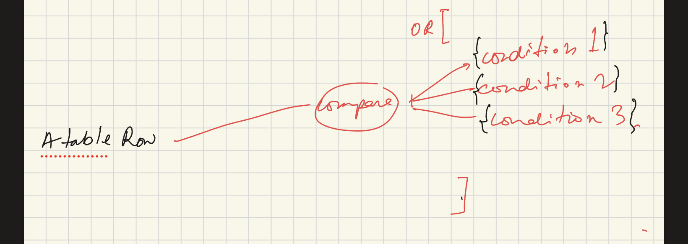

# WHAT IS IT ?
- it is a logical filter operator used inside a where clause (such as findMany, findFirst, updateMany, or deleteMany) telling which records get picked, and which records get ignored.

```javascript
where:{
    OR:[]
}

```
- one gotcha before we start: an empty array is NOT "no filter".
- `OR: []` → nothing can pass, so 0 rows. `AND: []` → everything passes (opposite).
- if you are not sure what a filter actually did, print the real query once → `new PrismaClient({ log: ["query"] })`

# WHAT IS A COLUMN ?
- every example in this note uses names like `column_name`, `city`, `age`. those are not random, they are COLUMNS of your model.
- a column → one field of the model → one vertical line in the database table. one row = one user/post, and it holds one value per column.
> "COLUMN = ONE FIELD OF YOUR MODEL"

## FROM SCHEMA TO `where`:
- take this schema:
```prisma
model User {
  id   Int    @id
  city String
  age  Int
}
```
- that gives you exactly 3 columns → `id`, `city`, `age`. `where` can only use names that exist here.
- if you type a name that is not in the schema, prisma will not compare it → it has no column to look at.
- so `{column_name: value}` in the examples is a PLACEHOLDER. you swap it for a real column → `{age: 30}`.

## DECODING THE WORDS USED IN THIS NOTE:
| what you see | what it means | real example | where it sits |
|---|---|---|---|
| column / `column_name` | one field of the model → one DB column | `city`, `age`, `role` | the KEY on the left |
| value | what you compare the column against | `"Delhi"`, `30` | the VALUE on the right |
| condition | one rule = `{ column: value }` | `{ city: "Delhi" }` | one item inside the array |
| `where` | the bag holding all the conditions | `where: { ... }` | top of findMany |
| row / record | one full user / post | `{ id: 1, city: "Delhi", age: 35 }` | what findMany returns |

- when a condition looks confusing, read it right to left → "Delhi, in the city column". the key is always the column, the value is always what you are looking for.
- the one line that clears most of the confusion:
```
column → WHICH field.   value → WHAT it should be.
```

## HOW `OR` WORKS:
-  OR → put your conditions in an array `[{condition 1},{condition 2},{condition 3}]`, and any record that passes even ONE condition will be returned.
- OR means: LESS strict. You are opening the door wider.
Any record that passes even one rule is included.
> "AT LEAST ONE CONDITION MUST BE TRUE"

### Example:
- Imagine you have these two conditions in your OR array:
```
city = "Delhi"
age > 30
```
- A record matches if:
```
city is Delhi  (even if age is 25) → included
age is 35 (even if city is Mumbai) → included
city is Delhi AND age is 35  → included
city is Mumbai AND age is 20 → not included
```
***IN PRISMA***

```javascript
OR:[{city:"Delhi"}, {age: {gt: 30}}]
```
- in SQL the same thing is:
```sql
WHERE city = 'Delhi' OR age > 30
```

## HOW TO WRITE (SYNTAX):
- lets comes to it through a javascript example:

```javascript
const conditions = [
  { role: "admin" },
  { role: "moderator" },
  { role: "editor" }
];
```
- Write a JavaScript function that checks whether a user matches at least one condition in this array.

SOLUTION:
```javascript
const user = { id: 1, role: "admin" };

const result = conditions.some(condition => {
  return user.role == condition.role
});
```
- .some() loops through the conditions.
- It checks whether the user matches each condition.
- If at least one condition matches, it returns true

> PRISMA HAS A SIMILAR STRUCTURE 
```javascript
await prisma.user.findMany({
  where: {
    OR: [
      { role: "admin" },
      { role: "moderator" },
      { role: "editor" }
    ]
  }
});

```
- think of findMany as a looping (like map , for loop ) where it loop through each user row
- each iteration goes through the 3 conditions → AT LEAST ONE must be true
- but be clear on one thing: that loop is a way to THINK about it, not what prisma does. it sends ONE query and the database checks the 3 rules on every row. 10,000 users = 1 query, not 10,000 queries.
- and if all the conditions are on the SAME column with a list of values, you don't need `OR` at all → `in` does it in one line:
```javascript
await prisma.user.findMany({
  where: { role: { in: ["admin", "moderator", "editor"] } }
});
```
- same result → `WHERE role IN ('admin','moderator','editor')` in SQL
- rule of thumb: same column(***meaning:*** if the given condition is to compare agaist the same columnm) + list of values → `in`. different columns → `OR`.


### IF THE CONDITION INVOLVE `>` OR `<`
- the operator goes INSIDE the column object, and the value stays a bare number:
```javascript
{ column_name: { gt: 67 } }
```
- NOT `{column_name: gt:{67}}` → as written that is not even valid javascript.
- the family:
- `gt` → `>` greater than
- `gte` → `>=` greater than or equal
- `lt` → `<` less than
- `lte` → `<=` less than or equal
> "COLUMN FIRST, THEN A BRACE, THEN THE OPERATOR"

### IF TWO CONDITIONS ARE ON THE SAME COLUMN (meaning: if the given condition is to compare agaist the same columnm)
- put both rules in the SAME brace. no `AND` needed:
```javascript
{ age: { gt: 30, lt: 50 } }   // 30 < age < 50
```
- `AND` is not for one column. it is for different columns, or for grouping two `OR` groups (below).
- small gotcha: `{ column: X }` and `{ column: { gt: X } }` can never both pass (the same value cannot be equal and greater at the same time). if you wrote that, you probably meant `gte`.

# IF BOTH CONDITION NEEDS TO SATISFY

## HOW `AND` WORKS:
- AND → put your conditions in an array `[{condition 1},{condition 2}]`, and a record is returned ONLY if it passes ALL conditions.
- AND means: MORE strict. You are narrowing the door.
Every single rule must be true for the record to be included.
> "ALL CONDITIONS MUST BE TRUE"

### Example:
- Imagine you have these two conditions in your AND array:
```
city = "Delhi"
age > 30
```
- A record matches if:
```
city is Delhi AND age is 35  → included
city is Delhi AND age is 25  → NOT included (age fails)
city is Mumbai AND age is 35 → NOT included (city fails)
city is Mumbai AND age is 20 → NOT included (both fail)
```
***IN PRISMA***

```javascript
AND:[{city:"Delhi"}, {age: {gt: 30}}]
```
- in SQL:
```sql
WHERE city = 'Delhi' AND age > 30
```

### WAIT — YOU DON'T EVEN NEED `AND` FOR THIS
- two keys side by side in the same `where` are ALREADY and-ed. prisma puts the `AND` in for you:
```javascript
where: { city: "Delhi", age: { gt: 30 } }
```
- same rows as the `AND: [...]` above. prisma docs say it straight → "the `AND` operator is not required"
- `AND` also takes a single object, not only an array:
```javascript
AND: { city: "Delhi" }
```
- so you write `AND` for one of two reasons: grouping (next section), or because you are building the `where` object in code and pushing conditions into an array.

### IF `OR` SITS NEXT TO A NORMAL KEY
- this is the one everyone gets wrong. the normal key gets AND-ed around the WHOLE or:
```javascript
where: { city: "Delhi", OR: [{ age: { gt: 30 } }, { age: { lt: 10 } }] }
```
- read it as:
```
city is Delhi AND ( age > 30 OR age < 10 )
```
- not as → `city is Delhi OR age > 30 ...`

### JAVASCRIPT COMPARISON:
- AND behaves like `.every()` in JavaScript — every condition must pass:

note: forget the `conditions` array from the OR part. there both sides were the same shape (`{role: ...}`), so `.every()` could work on it. `AND` is usually on DIFFERENT columns, so each rule has to be its own function:

```javascript
const checks = [
  u => u.city === "Delhi",
  u => u.age > 30
];

const result = checks.every(check => check(user));
```
- `checks` holds 2 functions, `user` goes into each one, ALL must return true.
- `.every()` loops through all conditions.
- If even ONE condition fails, it returns false.
- Only returns true when ALL conditions pass.

> PRISMA EXAMPLE
```javascript
await prisma.user.findMany({
  where: {
    AND: [
      { city: "Delhi" },
      { age: { gt: 30 } }
    ]
  }
});
```

### WHEN `AND` IS ACTUALLY NEEDED — TWO `OR` GROUPS
- you cannot put two `OR` keys in the same object, the second one overwrites the first. this is when `AND` earns its place:
```javascript
where: {
  AND: [
    { OR: [{ city: "Delhi" }, { city: "Mumbai" }] },
    { OR: [{ role: "admin" }, { role: "editor" }] }
  ]
}
```
- read it as:
```
(city is Delhi OR city is Mumbai) AND (role is admin OR role is editor)
```
> "AND IS THE GLUE BETWEEN TWO OR GROUPS"

## OR vs AND — QUICK SUMMARY:
| | OR | AND |
|---|---|---|
| Strictness | Less strict | More strict |
| Records included | At least one condition passes | All conditions must pass |
| JS equivalent | `.some()` | `.every()` |

- the `.some()` / `.every()` row is a way to THINK about it, not what prisma runs → it is still one SQL query in the end.


