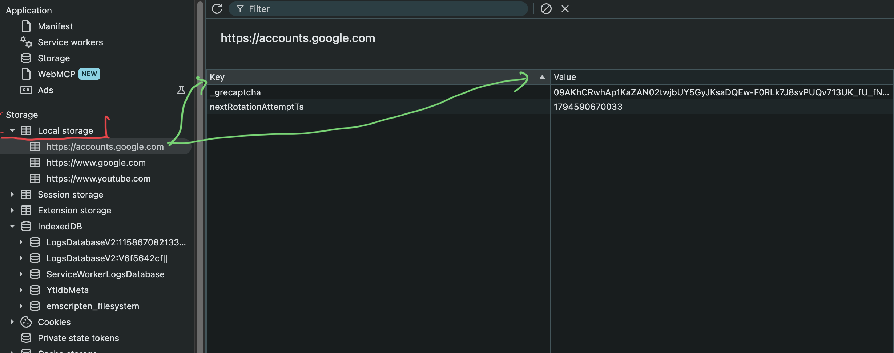
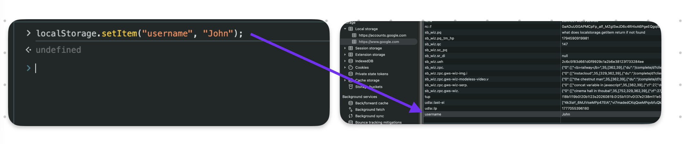

---
title: localStorage
description: how to use localStoarge in a project 
type: NOTE
year: 2026
tags: [frontend, browser, react, javascript]
---
##

## BASIC POINTS: 
- it is in the form of `key:value` pair 
- value: it is only text , (not other data like array or objects ), IF YOU have to store them then  use `JSON.stringify(object)`
- when you do `getItem` convert those (if you have stored object or array) back using `JSON.parse(key)`
- if `getItem` the item is not present it return `null`

## CORE IDEA OF localStorage IN ONE SENTENCE :
> “The website remembers something about you, without asking the server.”
This is what makes it different from a normal variable — a normal variable disappears when you close the page. localStorage does not

## EXAMPLE: 
```javascript
// User turns ON dark mode
localStorage.setItem("theme", "dark");

// Next day, user opens the website again...
let savedTheme = localStorage.getItem("theme");

if (savedTheme === "dark") {
    document.body.style.background = "black";
    document.body.style.color = "white";
}
```


## SAVING A DATA :


## DELETING A DATA:
```javascript
localStorage.removeItem("username");// Remove one item
localStorage.clear();// Remove everything

```

### NOTE:
> Two keys with the same name can exist — but they won’t. The second one will silently destroy the first.

## example:
```javascript
localStorage.setItem("color", "blue");
localStorage.setItem("color", "red");  // same key!

console.log(localStorage.getItem("color")); // Output: "red"

```
- “blue” is gone forever. No error, no warning — it just gets replaced.