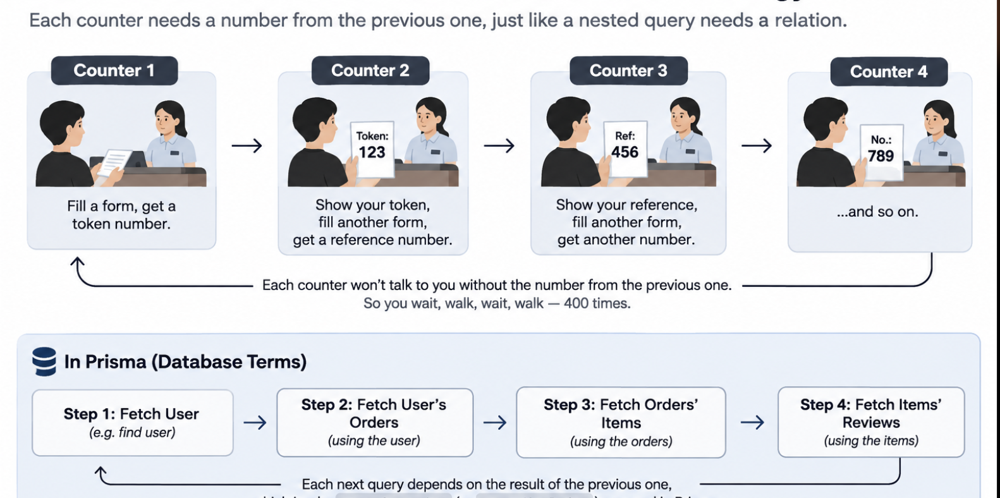

### ANALOGY: Registering at a government office.

You go to Counter 1, fill a form, get a token number.
Walk to Counter 2, show your token, fill another form, get a reference number.
Walk to Counter 3, show your reference number, fill another form, get another number.
Walk to Counter 4...

Each counter won’t talk to you without the number from the previous counter. So you wait, walk, wait, walk — 400 times.

***Nested writes is the single online form where you fill everything out at once and hit submit. The system internally figures out which number goes where.***


>So the problem is database operation where something from the previous opeartion is required in the next operation , 

> ***`nested write`*** fix this issue 

## NESTED WRITES:
#### condition:
the tables should have a @relation(1:m , m:m etc) , among each other , otherwise `nested write` is not possible 

#### SYNTAX:
- nested writes are written inside the data object of a database operation, using a relationship field 

##### data object:

```javascript
create({
    data:{} // this is the data object , nested write is written inside this {}
})
```

##### relationship field??
- courses: relationship ship 

```javascript
model Student {
  id        Int        @id @default(autoincrement())
  name      String
  courses Course[]
}

model Course {
  id        Int     @id @default(autoincrement())
  coursename      String
  StudentId Int
  whichStudent   Student @relation(fields: [StudentId], references: [id])
}

```

##### 

```javascript
data:{
    name: "Your name"
    courses:{
        create:{
            coursename:"course_name"
        }
    }
}


```
- create can be a single object or an array of object 


1. The database still does the same work — but instead of you running back and forth handing each piece one at a time, you hand over the complete blueprint and let Prisma handle the rest

2. You describe the whole structure upfront, and Prisma figures out the correct order internally. You don’t manage IDs manually — Prisma connects everything behind the scenes.
