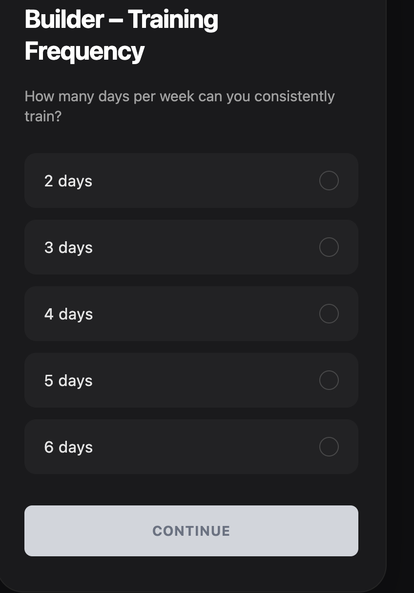

---

title: HOW TO DISPLAY MANY BUTTONS USING A SINGLE BUTTON WITH .MAP()
description: explanation with example on how to avoid repeating button JSX by storing data in an array and using .map() to render all buttons from one template, including how selected state works with it
type: NOTE
year: 2026
tags: [react, map, buttons, array, JSX, rendering, state]

---


## DUMB WAY :
- you can use many button 

```javascript
<button>2 days</button>
<button>3 days</button>
<button>4 days</button>
<button>5 days</button>
<button>6 days</button>

```

## NOT DUMB WAY:
- you write a single <button> and use .map() to repeat it for each item in an array:

```javascript
// 1. Create an array with all the data you need
const options = [
  { value: 2, label: "2 days" },
  { value: 3, label: "3 days" },
  { value: 4, label: "4 days" },
  { value: 5, label: "5 days" },
  { value: 6, label: "6 days" },
]

// 2. Write the button once inside .map()
{options.map((option) => (
  <button key={option.value}>
    {option.label}
  </button>
))}


```