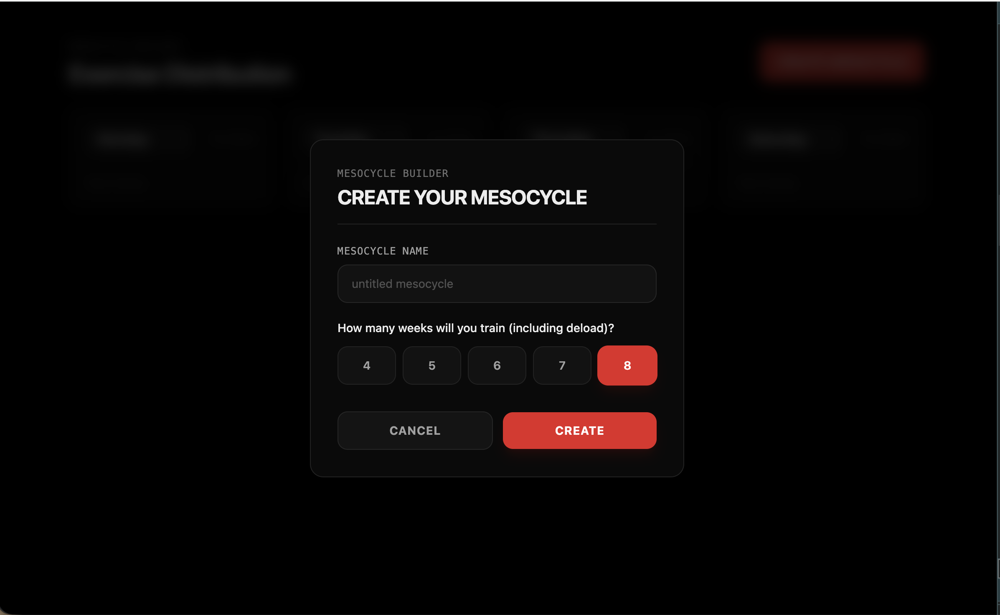

---

title: Popup effect in react
description: How popup effect in tailwind is created
type: NOTE
year: 2026
tags: [react, practical, tailwind]

---


The popup effect comes from three other things:
- fixed → leaves page flow
- inset-0 → covers the screen
- bg-black/60 → dims what's behind


a visual artifcats that show how these 3 points work together:
file:///Users/bilsonyumnam/Desktop/fullstack%20project/Hypertrophy/frontend/popup-demo.html
```jsx
<div classname="fixed inset-0 bg-black/60 z-50">
    <div></div> // this div need to have a color slightly different from the parent 
<div>

```
 The card needs its own background that differs from the dim layer — that contrast is what reads as "a separate surface floating above the page".because imagine, if the 2 div have the same color , even though popup effect is applied , you will not see the diference (just imagine 2 same color on top of another , do yu see a popup ????)

> Rule: the dim is never the same tone as the card. If they match, the edge disappears and the popup looks broken.

